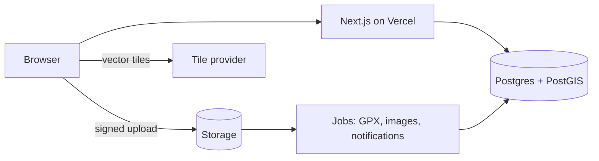

# Architecture (concise)

Detail: [docs/05](docs/05-technical-architecture.md), [docs/06](docs/06-data-model.md), [docs/10](docs/10-component-architecture.md), [docs/11](docs/11-security-and-moderation.md).

**Shape:** one Next.js (App Router, TypeScript) app on Vercel, an independent site at `moto-trails.com` (other hostnames 301 to it; footer states it is a subsidiary of myto-moto). Managed PostgreSQL + PostGIS with Auth (Supabase: free tier for development only, Pro from beta) and object storage for media and GPX (Supabase Storage in development; **Cloudflare R2** before beta, no egress fees). Background jobs for GPX and image processing. MapLibre GL for maps. No microservices and no search cluster in the MVP; a versioned public API (`/api/v1`) is added right after the web MVP for the Trails companion app and Myto Navi ([docs/14](docs/14-platform-contract.md)). Monorepo: `apps/web`, `apps/mobile`, shared `tokens`, `domain`, `api-client` packages.

**Key decisions**
- Trails are stable; content is versioned (`trail` → `trail_revision`); edits go through moderation while the old revision stays live.
- Access class, operational condition and verification level are independent, evidence-backed, and expire.
- Geometry and GPX are public only after moderation and only if the access class allows; sensitive trails publish reduced geometry.
- Search = PostgreSQL full-text + trigram + PostGIS, plus an own gazetteer of Indian places (alternate names) for "Bangalore"-style searches, "near me", and approximate travel time (real routing later). Sensitive trails use an approximate public point for distances.
- Clients: web, Trails app (background ride recording while another navigation app runs; submits drafts), Myto Navi (Android hardware with SIM; offline-first sync). One API, one submission/moderation pipeline; GPX exports are plain GPX 1.1 with access status in standard fields.
- Donations: hosted payment page in the MVP; Myto (company) receives funds.
- Reads via server components and typed queries; writes via server actions validated with shared Zod schemas; authorisation in code and in the database (RLS).
- Layering: `app → features → ui → tokens`; business rules in pure `domain/`; server code behind typed loaders.

**The phone app (built, `apps/mobile`):** Expo / React Native, named Myto Moto, local first. It talks only to the website's `/api/v1` with a device token and never to the database. Rides, journal, to-dos, documents and fuel costs live on the phone; group rides, check-ins, condition reports and shared routes go through the API ([ride companion](docs/superpowers/specs/2026-10-28-ride-companion-features-design.md)). Maps are OpenStreetMap through MapLibre. Route planning calls two free public services directly from the phone, Photon for place search and Valhalla for road routes ([route planning](docs/superpowers/specs/2026-10-29-route-planning-design.md)); neither needs a key. Reminders and the ride-controls notification are local notifications, with no push server ([notifications](docs/superpowers/specs/2026-10-28-notifications-design.md), [ride notification](docs/superpowers/specs/2026-10-29-ride-notification-design.md)).

**Verified about the Myto site:** Next.js (Turbopack) on Vercel (Mumbai), Tailwind v4 tokens, Geist + Michroma. **Not verified:** its auth, database, APIs, repo. See [docs/01](docs/01-existing-system-audit.md).
