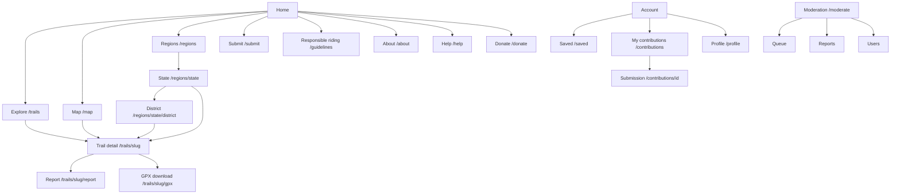
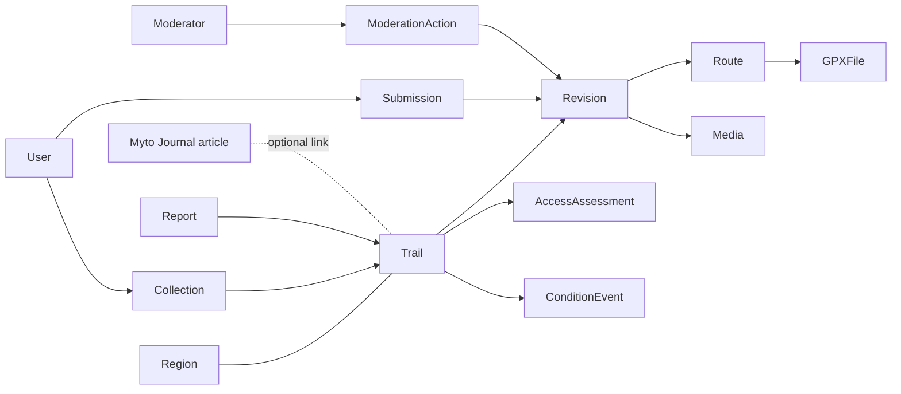

# 03 — Information architecture

## 1. Sitemap

**Changes from the brief's structure**
- *Discover trails* and *Map explorer* are **one page with two views** (`/trails` and `/trails?view=map`), because they share filters and state. `/map` is a shortcut alias.
- *States and regions* become `/regions` (a geographic browse hub). Regions are a browsing aid, not the primary entry point.
- *Responsible riding guidelines* moves to a persistent footer and in-context links; it is also linked from every permission-required trail.
- *Wishlist* is named **Saved** in UI copy (shorter, matches the action "Save").

## 2. URL strategy

Canonical host: `https://moto-trails.com` (independent site; other hostnames 301 to it, see doc 05 §1). Place and radius appear in discovery URLs as slugs (e.g. `/trails?near=bengaluru&radius=150`), never as raw user coordinates.

| Page | URL | Note |
|---|---|---|
| Trail | `/trails/{slug}` | Flat slug, globally unique, e.g. `/trails/kudremukh-forest-track`. Geography is carried by breadcrumb and structured data, not the URL, so changing a district never breaks links. Renames create a permanent 301 from the old slug. |
| Explore | `/trails?state=kerala&terrain=gravel,mud&access=public` | All filters are query params; canonical points to the unfiltered or single-facet page |
| State | `/regions/{state}` | Indexable only if ≥ 3 published trails; otherwise `noindex` and redirect-free |
| District | `/regions/{state}/{district}` | Same rule |
| GPX | `/trails/{slug}/gpx` | Auth-free for allowed trails, rate-limited, `Content-Disposition: attachment` |

Rationale for flat trail slugs vs `/trails/kerala/…`: geography changes (districts split, a trail spans two states) and the URL would have to change with it. Landing pages under `/regions` supply the geographical hierarchy for SEO without making trail URLs fragile.

## 3. Navigation

**Primary (desktop header and mobile bottom bar):** `Explore` · `Map` · `Submit a trail`
**Secondary (header right):** search (⌘K / `/`), `Saved`, account menu (Contributions, Profile, Sign out) or `Sign in`.
**Footer:** Regions, Responsible riding, About, Help, Donate, Terms, Privacy, and the line "Myto Trails is a subsidiary of myto-moto" linking to myto-moto.com. The same statement appears on About and the legal pages.

**Mobile:** a bottom tab bar with Explore, Map, Submit, Saved, Account — the five most-used destinations, all within thumb reach, outdoors with one hand. The top bar shows the Myto Trails mark and search only.

The header carries only the Myto Trails mark (no parent-brand link): Trails is an independent product, and the relationship to myto-moto is stated in the footer, About and legal pages.

Moderators see a `Moderate` item in the account menu only (not a separate site).

## 4. Page inventory

| # | Page | Auth | Purpose | Rendering |
|---|---|---|---|---|
| 1 | Home | none | Orient, search, featured and recently verified trails, region entry | Static + ISR |
| 2 | Explore (list + map) | none | Core discovery | Server-rendered list, client map |
| 3 | Trail detail | none | Decide and prepare | ISR, revalidated on edit |
| 4 | Region (state/district) | none | Geographic browse + SEO | ISR |
| 5 | Report issue (dialog; page fallback) | account | Correct information | Client |
| 6 | Sign in / up | none | Authentication | Client |
| 7 | Saved | account | Wishlist | Dynamic |
| 8 | Submit a trail (6 steps) | account | Contribution | Client, autosave |
| 9 | My contributions | account | Status list | Dynamic |
| 10 | Submission detail / edit | owner | Feedback, resubmit | Dynamic |
| 11 | Profile and settings | account | Name, avatar, notifications, data export/delete | Dynamic |
| 12 | Public contributor profile (name, trails contributed) | none | Attribution | ISR |
| 13 | Moderation: queue | moderator | Work list | Dynamic |
| 14 | Moderation: review panel | moderator | Review revision, GPX, media, access | Dynamic |
| 15 | Moderation: reports | moderator | Triage | Dynamic |
| 16 | Admin: users, regions, audit log | admin | Management | Dynamic |
| 17 | Responsible riding | none | Policy and guidance | Static |
| 18 | About, Help, Terms, Privacy | none | Content; each states the subsidiary relationship | Static |
| 18b | Donate | none | Explain who receives donations, where funds go, independence from listings; link to hosted payment page | Static |
| 19 | 404 / 410 / closed-trail notice | none | Permanently closed trails return 200 with a closed notice (not 404) to preserve links; deleted trails return 410 | — |

## 5. Key screen hierarchy

**Trail detail (reading order = decision order)**
1. Identity: name, region breadcrumb, contributor.
2. **Go/no-go strip:** access class · operational status · verification level + date · difficulty · distance · duration · GPX button · Save.
3. Route map (with list alternative) and elevation profile.
4. Summary and riding notes.
5. Terrain, suitability, season.
6. Hazards and safety.
7. Gallery.
8. Access details and evidence summary; responsible-riding note.
9. Facilities (verified only).
10. History and "Last verified".
11. Report an issue; related trails.

**Explore:** search → active filters → results count → list/map. Filters collapse to a single panel on mobile.

## 6. Content relationships

A trail belongs to one *primary* region (its start location's district) and may be tagged to additional districts and states when it crosses a boundary.

## 7. Terminology (one word per concept)

| Use | Avoid |
|---|---|
| Trail | route, track (except "GPX track"), ride |
| Access | legality, permission status |
| Condition (operational status in schema) | state, availability |
| Verified | confirmed, approved (approved is moderation-only) |
| Save / Saved | wishlist, favourite, bookmark |
| Submit a trail / Contribution | upload a route |
| Report an issue | flag, complain |
| Difficulty: Easy · Moderate · Hard · Expert | Beginner/Pro |
