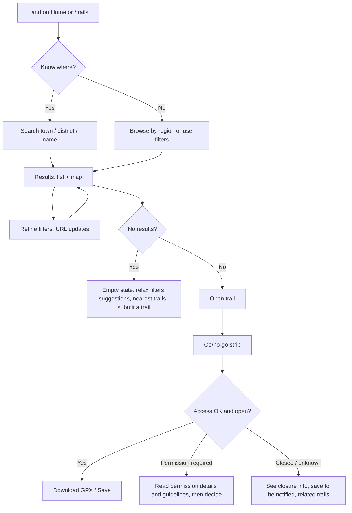
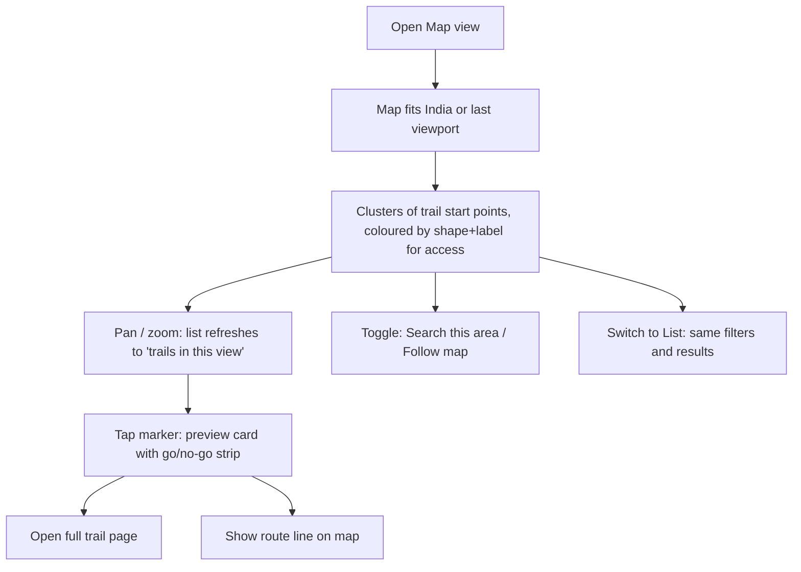
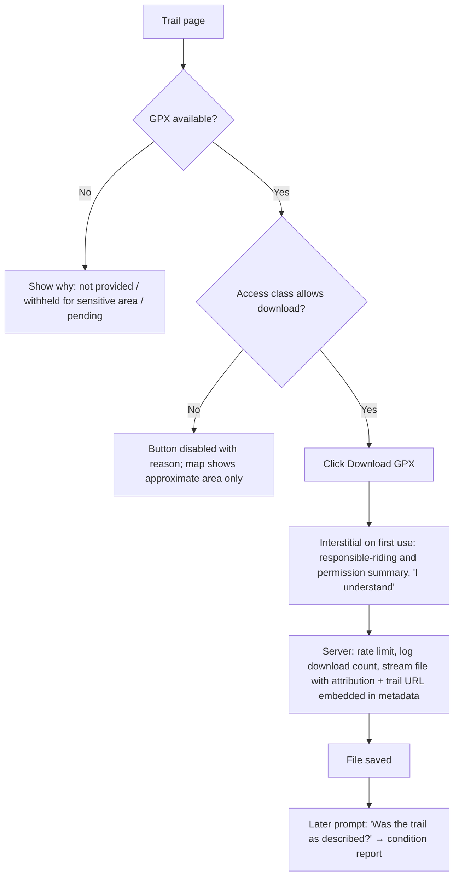
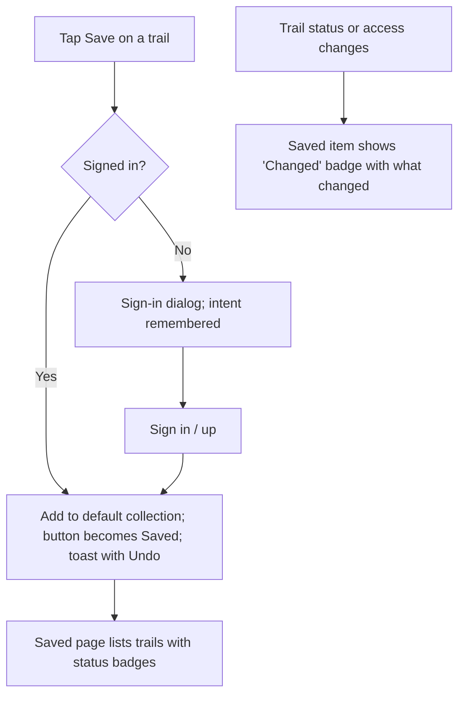
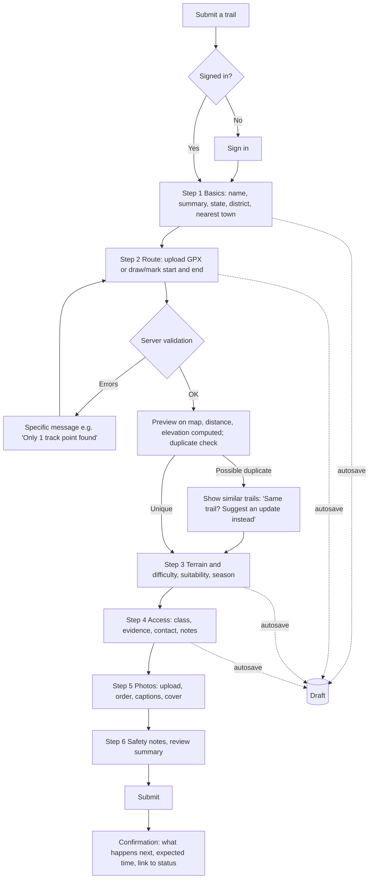
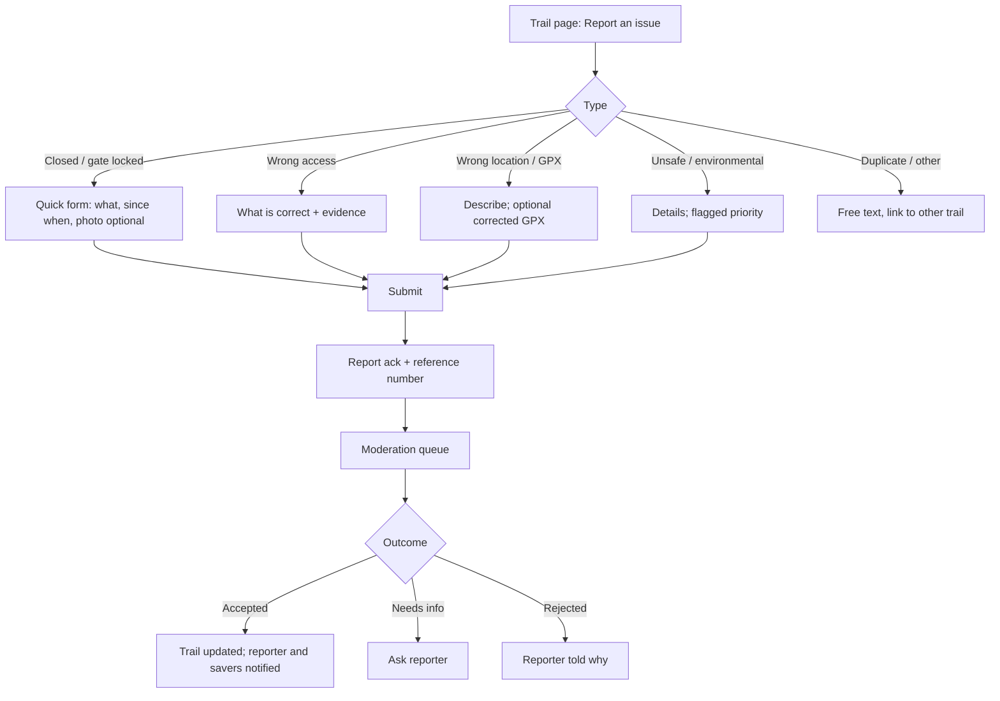
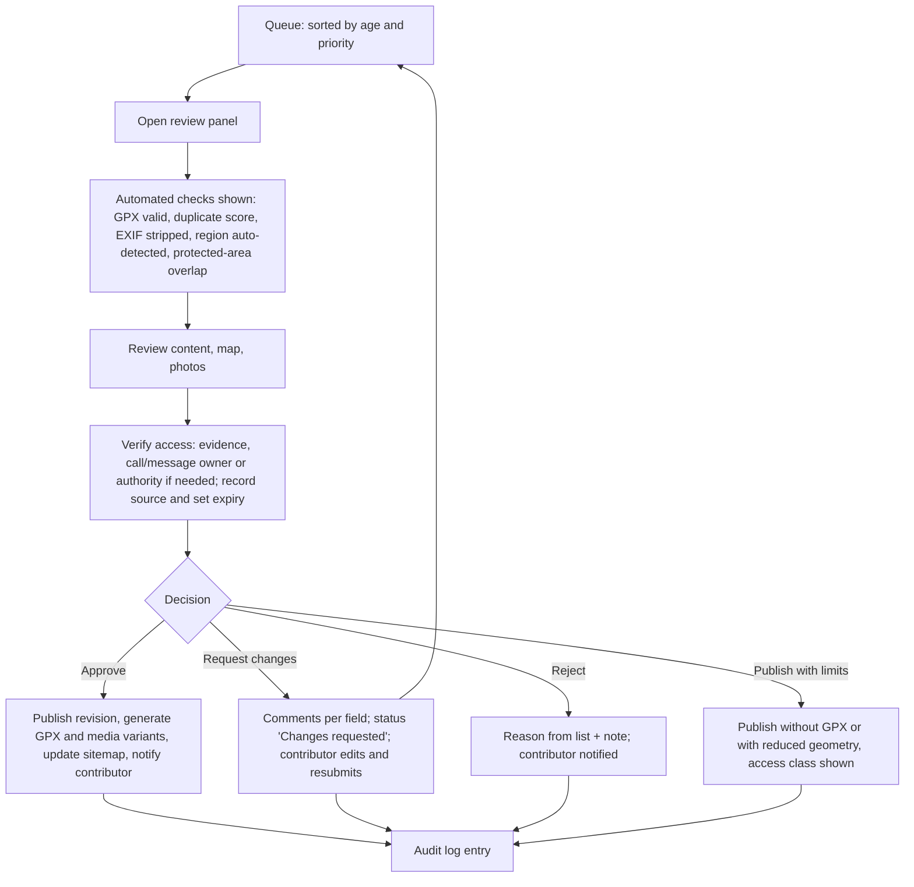

# 04 — User flows

## 1. Discovering a trail

Design notes: filter state lives in the URL; "Hide closed" is the default and is shown as a removable chip, not hidden. The result count is always visible and announced to screen readers when it changes.

## 2. Exploring on the map

Only trail *start points* (with privacy-adjusted precision where required) are served for the map overview. Full route geometry loads on selection. A text list of "trails in view" is always available and is the accessible equivalent.

## 3. Viewing and downloading a GPX

The downloaded file is a **regenerated, sanitised** GPX (our own writer), not the raw upload: metadata and extensions stripped, name, description, licence, source URL and "verified on" date added.

## 4. Saving a trail

Anonymous saves are not stored locally in MVP (avoids a merge problem); the intent is replayed after sign-in.

## 5. Submitting a trail

Each step validates only its own fields; a step indicator shows completion; leaving and returning resumes the draft. Photos upload in the background with per-file progress; steps can be completed in any order after Step 1.

## 6. Correcting or reporting information

A single *closure report* does not unpublish a trail by itself; it adds a visible "Reported closed on {date}, awaiting review" notice (condition = *unknown*) so riders are warned immediately. Two independent closure reports within 14 days, or one moderator action, switch the condition to *temporarily closed*. Environmental-concern reports go to the top of the queue and can trigger an immediate moderator "hold" (trail hidden pending review).

## 7. Moderating a submission

Two-person rule for risky publications: any trail classified *Restricted*, or overlapping a mapped protected area, requires approval by a second moderator or admin.
