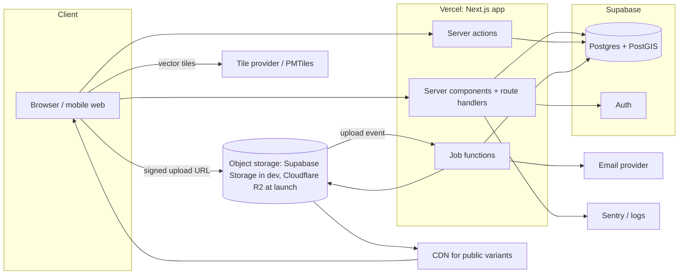
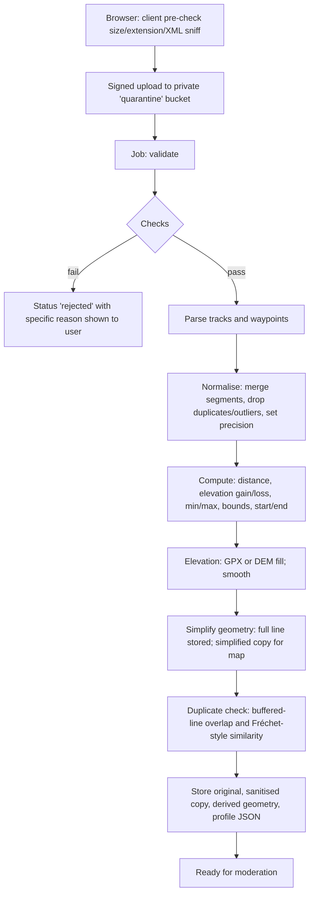

# 05 — Technical architecture

Guiding rule: **the smallest architecture that can hold 5,000 trails and 500 contributions a month, and that does not need rebuilding at 10×.** Prices and quotas of third-party services below are *not verified* — they change; confirm before committing (decision D-6).

## 1. Placement: section, subdomain, or independent domain?

| Option | Pros | Cons |
|---|---|---|
| A. Section inside the existing Next.js app (`myto-moto.com/trails`) | Shared domain authority, one deploy, shared session cookie | Couples a user-generated-content product (uploads, moderation, DB, heavy map JS) to the shop; one repo/CI for two teams and risk profiles; a trail-side incident can break checkout |
| **B. Separate Next.js app on `trails.myto-moto.com`** | Independent deploys, data, scaling, failure domain and roadmap; same platform and skills; easy to give the product its own identity | Search engines treat a subdomain as a separate site; cookies/sessions not shared by default |
| C. Separate app *served at* `myto-moto.com/trails` (Next.js multi-zones / Vercel rewrites) | Independence of B plus SEO benefit of A | Slightly more routing configuration; asset prefix and cross-zone navigation need care |
| **D. Independent app on its own domain, `moto-trails.com`** | Own product identity, "trails" in the domain, suits a global audience, clean separation | Starts with no inherited authority; the name "Moto Trails" differs from the parent brand spelling "Myto"; no shared cookies with myto-moto.com |

**Decision (D-1, revised on your instruction): D, an independent product at `moto-trails.com`.** Moto Trails is positioned as a subsidiary of myto-moto, stated in the footer, the About page and the legal pages, and linked both ways, but it is its own site.
- **Canonical host:** `https://moto-trails.com` (apex, no `www`). Canonical tags, sitemap, Open Graph URLs, emails and GPX metadata all use one `SITE_URL` config value.
- **Redirects (301, path and query preserved):** `www.moto-trails.com`, `trails.myto-moto.com` (if ever created) and, if registered, `mytotrails.com` / `myto-trails.com` (optional: for people who search for the parent brand name plus "trails") all redirect to the canonical host. Configured at the Vercel domain level.
- **Consequences:** no shared cookies with myto-moto.com, so Trails has its own accounts (see §6); search authority is built from scratch, so cross-links from myto-moto.com and the Journal matter; the `moto-trails.com` registration must be confirmed (an earlier lookup suggested it was unregistered; verify with a registrar).
- **Reversibility:** because everything keys off `SITE_URL`, moving to a different canonical host later is a one-time migration with 301s, not a rebuild.
- **Search-engine note:** the claim that a subdomain is "treated as a separate site" is a common belief, not something verified here; the practical SEO difference between options is smaller than content quality, unique pages and inbound links.

## 2. Recommended stack

| Layer | Choice | Why | Main alternative and why not (for now) |
|---|---|---|---|
| Framework | **Next.js (App Router), TypeScript** | Matches the Myto site (verified), server rendering for SEO, server actions/route handlers remove the need for a separate API tier | Remix/SvelteKit: fine, but adds a second stack for the Myto team |
| Styling | **Tailwind CSS v4 with shared CSS tokens** | Matches Myto (verified); tokens are CSS variables | CSS Modules: more verbose for token reuse |
| UI primitives | **Radix UI / React Aria** headless primitives, own styling | Accessibility (dialogs, comboboxes, tabs) done correctly | Building from scratch is error-prone; full kits (MUI) fight the brand |
| Forms | **React Hook Form + Zod** | Same Zod schemas validate client and server | Formik: heavier |
| Client state | URL state (`nuqs`-style) + React Query for server data; no global store | Filters belong in the URL; very little shared client state | Redux/Zustand: not needed |
| Maps | **MapLibre GL JS** | BSD licence, no per-load fee, vector tiles, terrain support, works with any tile source | Google Maps (cost, ToS limits on storing/exporting data, not trail-oriented); Mapbox GL (proprietary licence, per-load pricing) |
| Database | **PostgreSQL 16 + PostGIS** | Relational data with real spatial indexes, full-text search, trigram matching, row-level security | MongoDB: weak for relations and spatial joins; SQLite/D1: PostGIS-class geography missing |
| DB host & auth | **Supabase** (Postgres + Auth + RLS), region nearest India (availability **unverified**). **Free tier for development and staging only; Pro (from $25/month) for beta and launch** | One vendor for DB, auth and policies; PostGIS; low operations burden. Free tier (checked 2026-10-24): 500 MB database, 50,000 monthly active users, but **projects pause after a week of inactivity and there are no automated backups**, so it is unsuitable for production. Pro: 8 GB disk, daily backups kept 7 days, never paused | **Neon** (Free: 1 GB, scales to zero after 5 minutes so first requests are slow; no auth included, needs Auth.js or similar; paid is pay-as-you-go): a close second if auth should stay separate from the database. Firebase and Cloudflare D1 lack real spatial queries. Self-hosted Postgres: more operations than a small team needs. Lock-in is low (plain Postgres); Supabase Auth is the only sticky part |
| Object storage | **Supabase Storage during development; Cloudflare R2 before beta**, behind a storage interface (switching is an adapter swap plus a one-off copy of test files and a change to link signing) | Free tier (checked 2026-10-24): 10 GB-month storage, 1M class A and 10M class B operations; **no egress fees**; $0.015/GB-month after. Supabase Free allows only 1 GB storage and 5 GB egress, too small for photo galleries | Supabase Storage: one vendor, but its egress and storage limits are the constraint |
| Image processing | **`sharp`** in a background job → fixed AVIF/WebP variants | Deterministic, strips EXIF, cheap | On-the-fly `next/image` for user uploads: unbounded transform cost |
| Background jobs | **A durable job runner (Inngest-class) or Vercel Queues/Cron**; one worker function per job type | GPX parsing, image variants, notifications need retries and must not block requests | A self-run queue (BullMQ + Redis): more infrastructure |
| Search | **PostgreSQL full-text + `pg_trgm` + PostGIS** | At ≤ 10⁴ trails, DB search is fast and keeps one source of truth | Algolia/Typesense/Meilisearch: extra service, sync complexity, cost; revisit only if facets over typo-tolerant text become slow |
| Email | Transactional email provider (Resend/Postmark class) | Status notifications, sign-in links | — |
| Errors/logging | Sentry + Vercel logs; DB slow-query logging | Standard | — |
| CI/CD | GitHub Actions → Vercel previews per PR | Standard | — |
| Testing | Vitest (units), Playwright (e2e, visual, a11y with axe), a handful of component tests | See doc 12 | — |

There is **no separate backend service**. Server code lives in the Next.js app, in a clearly separated `server/` layer (doc 10), so it can be extracted later.

## 3. System diagram

Environments: `local` (Docker Postgres+PostGIS), `preview` (per-PR Vercel + a shared preview DB branch), `staging` (own project, anonymised copy), `production`. Secrets via Vercel environment variables, separate per environment. Migrations are versioned SQL files run in CI; production migrations require a manual approval step.

## 4. Frontend architecture
- **Rendering:** trail pages, region pages and home are server-rendered and cached (ISR with tag-based revalidation when a revision is published). The explore list is server-rendered from URL params so it is shareable and indexable-safe. The map is a client island, lazy-loaded after first paint, so the list is usable if tiles or the map library fail.
- **Layering:** pages in `app/` only compose; features hold domain UI; `ui/` holds design-system primitives; no component imports from `server/` directly except through typed data-loader functions (doc 10).
- **Design tokens:** one shared `tokens.css` (Tailwind v4 `@theme`) published as an internal package, with a Trails override layer (doc 09).
- **Map integration:** one `MapView` wrapper owns the MapLibre instance; markers, route lines and controls are layers it receives as props. The map never holds business logic. Style definitions live in `map-styles/` and are provider-agnostic.
- **Mobile:** system fonts fallback for slow networks, no web-font blocking (`font-display: swap`), image `sizes` attributes everywhere, intersection-observer lazy loading, 44 px minimum touch targets, bright-light-safe contrast.

## 5. Backend architecture and API strategy
- **Reads:** server components query the database through typed query functions (`server/queries/*`). No public REST API in MVP.
- **Writes:** server actions for form submissions; route handlers only for what must be a URL (GPX download, upload-URL issuing, webhooks, sitemap, OG images).
- **Validation:** Zod schema per action input, shared with the client form. Never trust the client.
- **Authorisation:** enforced twice — in server code (role checks, ownership) and in the database (Row Level Security) as a backstop. Unpublished revisions and drafts are readable only by their owner and moderators.
- **Versioned public API (`/api/v1/…`)** is **not needed by the web MVP but is required before the companion app and Navi integration** (§14, doc 14). The web MVP is built API-ready: business rules live in `domain/`, handlers are thin, and `server/queries` and `server/actions` are the boundary an API wraps. Server actions are only usable from our own web pages, so the API is separate route handlers with an OpenAPI description.

## 6. Authentication and authorisation
- **MVP:** passwordless email link and Google sign-in via the managed auth provider; no passwords stored by us. A separate Trails account system.
- **Sharing with myto-moto.com:** with an independent domain, cookies cannot be shared, and the shop's auth is unverified (doc 01). Decision: separate Trails accounts at launch. If the Myto team later confirms the shop's auth supports OIDC or similar, add "Sign in with Myto" as an additional provider, linking by verified email.
- **Apps and devices:** the companion app and Navi use token-based sign-in (OAuth with PKCE for the app; revocable device-scoped tokens for Navi), not cookies. Details in doc 14.
- **Roles:** `rider` (default), `moderator`, `admin`. Role stored in a `user_roles` table; regional moderator scope added in stage 2 via a `region_id` column that is nullable from day one.
- **Sessions:** HTTP-only, secure, same-site cookies; short-lived access tokens; moderators and admins can be required to enable second-factor (decision D-9).

## 7. Mapping solution

Requirements: India coverage, outdoor-friendly style (contours, hillshade, tracks and paths, forest and protected area boundaries), vector tiles for MapLibre, predictable cost, attributable licence.

| Option | Licence/cost model | Fit | Risks |
|---|---|---|---|
| **MapTiler Cloud** (OSM-based, outdoor/terrain styles, terrain-RGB) | Commercial plans with free tier; per-request quotas | Fast to start; good outdoor style; terrain tiles for elevation | Quota overage; vendor pricing changes |
| **Stadia Maps** | Similar | Good vector styles | Smaller terrain offering |
| **Protomaps (self-hosted PMTiles on object storage/CDN)** | Open licence (OSM data under ODbL, attribution required); cost = storage + bandwidth | Predictable cost, fully ours, works offline later (stage 3) | No contours/hillshade out of the box; you build and update the extract yourself |
| OSM Foundation tile servers | Free, but usage policy forbids heavy/commercial production use | Prototyping only | Will be blocked at scale |
| Google Maps | Per-load billing, restrictive ToS | Familiar imagery | Cost, restricts route data usage, not MapLibre-compatible |
| Mapbox | Per-load billing, proprietary GL licence on newer versions | Excellent | Cost and lock-in |

**Recommendation:** MapLibre GL JS with **MapTiler Cloud (or equivalent) for the MVP**, behind a style-URL config value and a documented attribution component. Plan **self-hosted Protomaps PMTiles for the basemap in stage 2/3** (India extract) plus Terrain-RGB for hillshade; this is the cost-ceiling and the path to offline packs for the companion app and Navi (whether commercial tile providers permit offline caching is unverified; self-hosted OpenStreetMap-derived tiles avoid the question). Always show attribution (OSM contributors + provider) exactly as the licence requires.

Elevation: use GPX elevation when present, otherwise sample a DEM (Copernicus GLO-30 or SRTM, both freely licensed) at processing time. Smooth the profile (moving average, spike filter) before computing gain, since raw GPS elevation overstates ascent.

Map failure mode: if tiles fail, the route polyline is still drawn on a plain background and the textual route description and list remain.

## 8. GPX processing pipeline

Checks: size ≤ 5 MB; XML well-formed with DTD and external entities **disabled**; root `<gpx>`; at least one track with ≥ 50 points or ≥ 500 m; coordinates in range and within India's bounding polygon (plus tolerance for cross-border trails flagged for review); time-ordered or contiguous; max speed sanity (flags teleport jumps, > 300 km/h); length ≤ 500 km; ≥ 80% of points within a plausible spacing.

Storage: original file (immutable, private), canonical sanitised copy (regenerated by our writer, public download after approval), geometry in PostGIS (`LineStringZ`, SRID 4326), simplified line (Douglas-Peucker with tolerance around 5 m) for map rendering, elevation profile as a down-sampled JSON array (≈ 200–500 samples). Coordinate precision: stored to 6 decimals (~0.1 m); public downloads rounded to 5 (~1 m) — still ample for navigation and discourages exact-location scraping of sensitive spots.

Library: a well-maintained GPX parser plus own validation. **Parsing happens in a job, not in the request**, with CPU and memory caps and a timeout.

Duplicate detection: (1) bounding-box + start/end proximity prefilter via GiST index; (2) similarity score = overlap of 25 m buffers divided by shorter length; ≥ 0.8 flags "likely duplicate" for user and moderator; (3) text trigram similarity on name and town.

## 9. Image processing
Upload → quarantine bucket → job: verify magic bytes and decode with `sharp` (rejects non-images and decompression bombs via pixel limits, max 40 MP) → auto-rotate → **strip all EXIF/XMP/IPTC** (the original, if retained, stays private; GPS from EXIF may be used *privately* to suggest a location to the contributor and moderator) → generate AVIF and WebP at 400/800/1200/1800 px widths, plus a 20-px blurred placeholder and dominant colour → store variants in the public bucket with immutable cache headers → mark ready for moderation. Roles: `cover`, `gallery`, `evidence` (private, moderators only: permission letters, signage photos). Max 10 MB per upload, ≤ 20 photos per trail.

## 10. Search architecture
- Table has a generated `tsvector` over name, town, district, state, summary (weighted); a `pg_trgm` index on name and place names for typos; GiST on geometry; B-tree/GIN on filter columns.
- Query function combines text rank, trigram similarity and a geographic bias if the user shared location.
- Filters compile to SQL; facet counts computed with one grouped query, cached per filter combination for 60 s.
- Map: `ST_AsMVT`-style or GeoJSON of start points in viewport; clustering client-side at ≤ 5,000 points.
- Place gazetteer: states and districts seeded from an open boundary dataset (to be licence-checked) for autocomplete and for auto-assigning region from a start point.
- Upgrade path if needed: Typesense or Meilisearch fed from a materialised view.

## 11. Hosting and deployment
Vercel (the platform the Myto site already uses; Mumbai region) for the app; Supabase for data (region nearest India — confirm). **Check the Vercel plan:** the free Hobby plan is intended for non-commercial use, so a commercial product needs a paid plan (terms and price unverified). Global visitors are served trail, region and home pages from the CDN cache; dynamic requests (sign-in, saves, submissions) go to the single database region and will be slower from far away, which is acceptable at launch. Preview per pull request; staging; production behind approval. Cron: nightly verification-expiry job, weekly stale-trail digest to moderators, daily backup verification. Backups: automated daily snapshots with point-in-time recovery if the plan supports it, **plus a weekly logical dump to separate object storage in another account**, and a quarterly restore test. Storage buckets: versioning on originals. Observability: Sentry (frontend, server), uptime check on `/` and a trail URL, alerts on job failure rate and queue age.

Cost drivers to watch: tile requests, storage egress, serverless function time for image/GPX jobs, database size (geometry is small), email volume.

## 12. Security strategy (summary — detail in doc 11)
Defence in depth: validate on client and server; private quarantine for all uploads; parse in constrained jobs; RLS plus app-level checks; rate limits on sign-in, uploads, GPX downloads, reports and search; CSRF protection on actions; strict CSP; no user HTML (Markdown subset rendered server-side with sanitisation); audit log for all privileged actions; secrets only in environment; dependency scanning in CI.

## 13. Search by place, "near me" and travel time

Requirement: searching "Bangalore" must show trails near Bangalore; choosing "Use my location" must place the rider on the map and list nearby trails with approximate time to reach and return.

**Place search**
- One search box with grouped suggestions: *Trails*, *Places*, *Regions*. Choosing a place sets a centre point and radius; results are trails within the radius sorted nearest first, shown as "42 km from Bengaluru".
- **Gazetteer:** a `place` table of Indian cities, towns and localities seeded from an open dataset (GeoNames is the candidate; licence to be checked, D-5) with alternate names (Bangalore / Bengaluru / Bengalooru), type, state, population rank and a point. Trigram index for typos. Chosen over a paid geocoding API to avoid per-search cost and vendor storage restrictions (no vendor's free tier was checked).
- **Radius:** default 150 km, chips for 50 / 100 / 200 / 300 km; "no trails within radius" suggests the nearest trails and a larger radius.
- **Query:** `ST_DWithin` on geography with a GiST index, ordered by distance; combined with all filters; URL carries the place slug and radius, never precise user coordinates.

**Near me**
- A "Use my location" button; the browser permission prompt appears only after the tap (HTTPS required). On success: blue dot with accuracy circle, map fits the dot and the nearest trails, list sorted by distance. If denied or unavailable: plain message and the place search as fallback. Coordinates stay in the browser; they are sent to the server only as a rounded value for the single query, not logged or stored.

**Travel time (phased, always labelled approximate)**
1. **Release 1:** straight-line distance × road-factor ÷ assumed motorcycle speed, shown as "≈ 3 h 30 each way · round trip ≈ 7 h". Factors configurable by terrain/region (ghat roads are slower). Honest about being an estimate.
2. **Next:** real driving time for the top N results via a routing provider's one-to-many matrix (candidates: OSRM or Valhalla self-hosted, or a hosted routing API; free tiers and terms unverified), cached by a rounded origin grid and trail. Provider chosen behind an interface once budget is set.
3. **Optional:** precomputed drive times from each trail's start to nearby major cities at publication time, giving accurate results for place searches at no per-user cost.
- **Trail shape** (`loop`, `out_and_back`, `point_to_point`) decides the return leg: for point-to-point trails the return starts from the end point.
- **Later filter:** "reachable within X hours" and a "fits in a day" view adding travel time to ride time.
- **Sensitive trails:** all distances for trails with `sensitivity != standard` use a deliberately approximate public point, so repeated "near me" queries cannot be used to triangulate a hidden start.

## 14. Clients and API

Three clients will use the same backend: the **web app**, the **Trails companion app** (touch app that records rides in the background, including while another navigation app such as Google Maps is in the foreground, and posts the GPX and details to Trails), and **Myto Navi** (Android hardware device with physical controls, a SIM and its own app, which reads trails and can record rides). The contract between them (API, GPX export format, authentication, sync, recorder submission format) is specified in [doc 14](14-platform-contract.md).

Implications for this architecture: a versioned public API before the app work starts; token-based authentication; resumable direct-to-storage uploads; client-generated idempotency keys on submissions; stable public trail IDs and a per-trail revision number; a monorepo with shared packages (doc 10); a recording spike on real budget Android phones before the app framework is chosen.

## 15. Donations

A "Donate" link (footer, About, and one quiet line after a GPX download; no popups, nothing that blocks a download) leads to `/donate`. **Myto (the company) receives the funds**, so the page says so plainly, does not describe donations as charitable or tax-deductible, states that donations do not influence listings, access verification, ranking or moderation, and says where money goes (maps, hosting, moderation time).
- **MVP:** a hosted payment page from a payment gateway (UPI and cards); no payment code and no card data on our servers. Gateway fees, UPI support and international-card availability are unverified; international cards usually need separate gateway approval.
- **Later:** integrated checkout with a signature-verified, idempotent webhook recording `donation` rows (amount, currency, status, date, optional receipt email, no card data); recurring donations.
- **Open items for the Myto accountant:** GST treatment of donation receipts; handling of payments from overseas donors.
- **Apps:** donating stays on the web only; in-app solicitation of payments is restricted by app-store policies (not verified, and subject to change).
