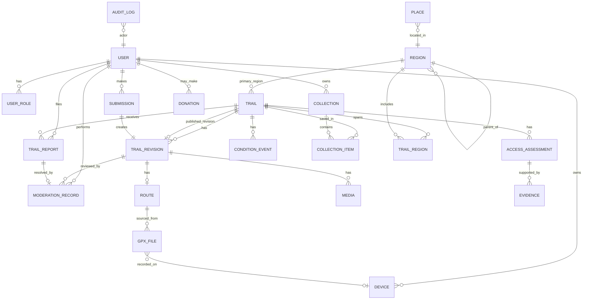
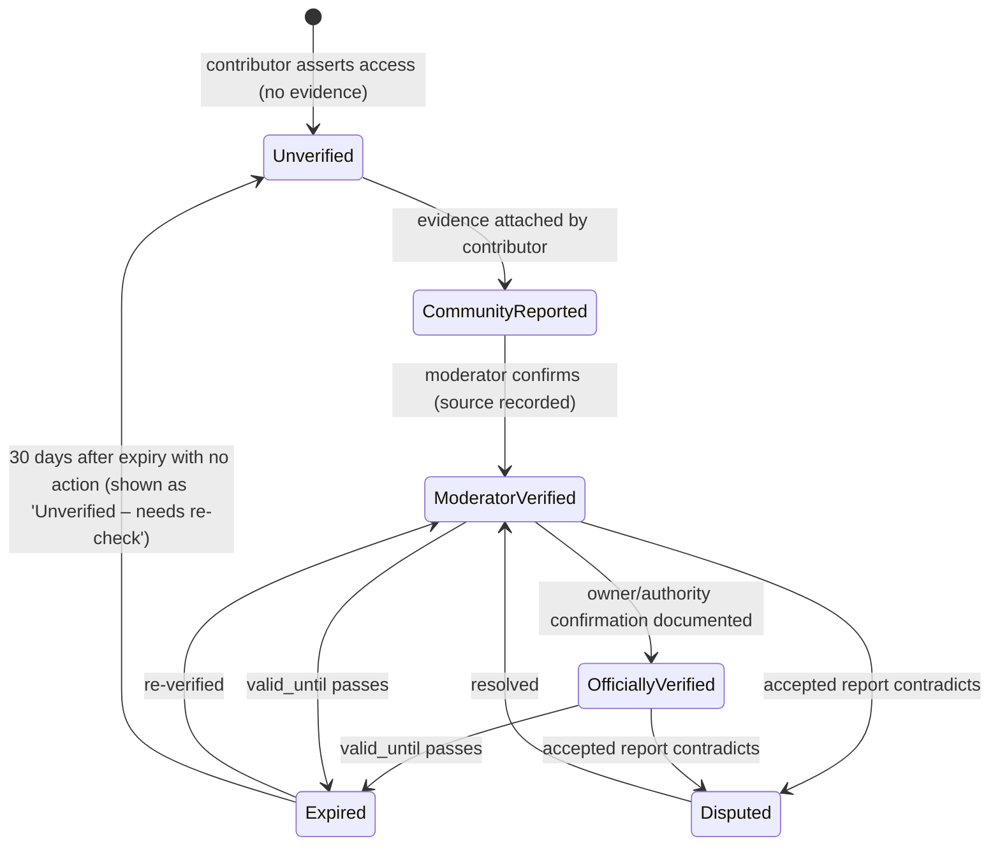

# 06 — Data model

Design principles: (1) a **Trail** is a stable identity, its *content* is a series of **revisions**; (2) **access, condition and verification** are separate, append-only records; (3) public views read only from *published* revisions; (4) soft-delete everywhere, hard-delete only for user data erasure; (5) geometry in PostGIS (SRID 4326); (6) every privileged change writes an audit row.

## 1. Entity-relationship diagram



New since the first draft: `PLACE` (gazetteer for place search), `DEVICE` (companion app and Navi tokens), `DONATION` (minimal record). `PLACE` and `DONATION` have no other foreign keys into trail data.

`TRAIL_VERIFICATION` from the brief is folded into `ACCESS_ASSESSMENT` (a verification *is* an assessment of access made by someone on a date). `TrailAccessInformation`, `TrailLocation` and `TrailRoute` are split as follows: location fields live on the revision; route geometry on `ROUTE`; access in `ACCESS_ASSESSMENT`. `Wishlist/WishlistItem` become `COLLECTION/COLLECTION_ITEM` with one auto-created default collection (the "Saved" list), so stage-2 multi-list needs no migration.

## 2. Entity definitions

Visibility: **P** public (published only), **A** authenticated owner, **M** moderator/admin, **S** system. "Writer" = who may create/modify.

### user
Purpose: an account. Fields: `id (uuid)*`, `email*` (unique, private), `display_name*` (2–40 chars), `handle` (unique slug, optional), `avatar_media_id`, `bio` (≤ 280), `home_state` (optional), `status*` (`active|suspended|deleted`), `created_at*`, `last_seen_at`, `notification_prefs` (jsonb). Writer: self (profile), admin (status). Visibility: display_name/handle/avatar/bio public if the user has a published contribution; email, status private.

### user_role
`user_id*`, `role*` (`moderator|admin`; riders have none), `region_id?` (stage 2 scoping), `granted_by*`, `granted_at*`. Writer: admin. Visibility: M.

### region
Purpose: geographic hierarchy for browsing, search and moderator scoping. `id`, `parent_id?`, `kind*` (`country|state|district`), `name*`, `slug*` (unique within parent), `boundary` (MultiPolygon, simplified), `bbox`, `published_trail_count` (denormalised), `is_indexable` (computed: ≥ 3 published trails). Writer: admin (seeded from an open dataset). Visibility: P.

### trail
Purpose: the stable identity. `id`, `slug*` (unique, kebab-case ≤ 80), `published_revision_id?`, `primary_region_id*`, `created_by*`, `created_at`, `first_published_at?`, `lifecycle*` (`draft|in_review|published|unpublished|archived`), `access_class_current*` (denormalised from latest valid assessment), `access_verified_until?`, `condition_current*` (denormalised), `verification_level_current*` (denormalised, computed with expiry), `sensitivity*` (`standard|sensitive|restricted_geometry`), `public_point` (approximate point used for maps and all distance/travel calculations when `sensitivity != standard`, so repeated "near me" queries cannot triangulate a hidden start), `public_id*` (stable, never reused; used by the API, Navi and the apps), `content_revision*` (integer incremented whenever publicly visible content, access class or condition changes; lets Navi and the app detect stale copies), `slug_history` (jsonb or table for redirects). Writer: S/M. Visibility: P (only when `lifecycle=published`; denormalised fields are public). Denormalised fields exist so listing queries need no joins and are updated in the same transaction as the assessment/event row.

### trail_revision
Purpose: the versioned, moderated content. `id`, `trail_id*`, `version_no*`, `author_id*`, `state*` (`draft|submitted|changes_requested|approved|rejected|superseded`), `name*` (3–80), `summary*` (40–400 chars), `description` (Markdown subset ≤ 5,000), `nearest_town*`, `district_id*`, `start_point*` (geography point), `end_point` (required when `route_shape = point_to_point`), `route_shape*` (`loop|out_and_back|point_to_point`; decides the return leg in travel-time estimates), `distance_km` (derived from route if present), `est_duration_min`, `elevation_gain_m`, `difficulty*` (`easy|moderate|hard|expert`), `difficulty_notes`, `terrain*` (array of controlled values: `dirt|gravel|mud|sand|rock|forest_track|mountain_road|riverbed|mixed`), `surface_notes`, `suitable_for*` (array: `adventure_tourer|dual_sport|enduro|scrambler|small_displacement|any`), `season_notes`, `best_months` (int[]), `hazards` (array of controlled values + free text), `safety_notes`, `facilities` (structured, each item with `verified_on`), `points_of_interest` (jsonb list of `{name, point, note}`), `licence_accepted_at*`, `created_at`, `submitted_at`, `decided_at`. Validation: name uniqueness check (trigram) within district; at least one terrain; difficulty required; summary has no URLs; start point inside India. Writer: contributor (own, until submitted), moderator (any). Visibility: P only for the revision pointed to by `trail.published_revision_id`; otherwise A (owner) and M.

### route
`id`, `revision_id*` (unique), `geometry*` (LineStringZ), `simplified_geometry*`, `bounds`, `distance_m*`, `elev_gain_m`, `elev_loss_m`, `min_elev_m`, `max_elev_m`, `point_count`, `has_timestamps`, `moving_time_s?`, `stopped_time_s?`, `avg_moving_speed_kmh?` (only when the source track has timestamps, e.g. app- or Navi-recorded; improves the estimated-duration field), `profile` (jsonb down-sampled), `public_precision` (`full|reduced|start_only`; set by `sensitivity`), `fingerprint*` (hash of normalised geometry for exact-duplicate lookup), `overlaps_protected_area` (bool), `computed_at`. Writer: S. Visibility: P only if published *and* `public_precision` permits; full geometry never exposed when `reduced|start_only`.

### gpx_file
`id`, `route_id?`, `uploaded_by*`, `source*` (`uploaded|app_recorded|navi_recorded`), `device_id?`, `client_id*` (client-generated UUID; makes retried uploads idempotent), `recorded_start_at?`, `recorded_end_at?`, `trim_applied` (jsonb: start/end trim made on the device or web, for privacy and trailhead cropping), `storage_key_original*` (private), `storage_key_public?` (sanitised copy), `sha256*`, `size_bytes*`, `status*` (`uploaded|validating|rejected|ready|retired`), `reject_reason?`, `validation_report` (jsonb: counts, warnings), `download_count`, `created_at`. Writer: contributor (upload), S (status), M. Visibility: original — M only (and owner); public copy — P only via the download endpoint when `trail.lifecycle=published` and `access_class_current` allows.

### media
`id`, `revision_id*`, `uploaded_by*`, `role*` (`cover|gallery|evidence`), `position*`, `caption` (≤ 160), `alt_text*` (required for cover/gallery), `credit` (default uploader display name), `storage_key_original` (private), `variants` (jsonb of public URLs + widths), `width`, `height`, `blurhash`, `captured_at?`, `exif_gps_private?`, `status*` (`uploaded|processing|ready|rejected|removed`), `moderation_flags`. Validation: ≤ 10 MB, ≤ 40 MP, JPEG/PNG/WebP/HEIC; exactly one cover. Visibility: `cover|gallery` P once published; `evidence` M only.

### access_assessment
Purpose: one statement about legal/physical access, made by someone, with evidence. Append-only. `id`, `trail_id*`, `revision_id?`, `access_class*` (`public|permission_required|private_no_access|restricted|unknown`), `permission_contact` (visible only to M unless the owner consented), `permission_instructions` (public text, e.g. "Obtain pass from range office, Mon–Sat"), `restrictions` (array: `forest_dept|protected_area|private_estate|seasonal_ban|permit|no_motor_vehicles|…`), `basis*` (`official_notice|owner_confirmed|authority_confirmed|rider_observed|map_data|none`), `asserted_by*`, `asserted_at*`, `verified_by?`, `verified_at?`, `valid_until?` (default verified_at + 12 months; 6 for seasonal; 3 for permission-based), `level*` (`officially_verified|moderator_verified|community_reported|unverified`), `superseded_by?`, `notes`. Rules: `officially_verified` requires an evidence row of kind `official_document|written_confirmation` and an authority name; `moderator_verified` requires `verified_by` with moderator role and at least one evidence row or a documented call; `private_no_access` can never be public-GPX. Writer: contributor can *assert* (level at most `community_reported`), moderator can *verify*. Visibility: class, restrictions, instructions, level and dates P; contact details M.

### evidence
`id`, `assessment_id*`, `kind*` (`official_document|written_confirmation|signage_photo|url|call_note|other`), `media_id?`, `url?`, `description*`, `captured_on?`, `added_by*`. Visibility: M; public shows only "N sources" and `kind` labels, not the files, unless the owner of the document agrees.

### condition_event
Purpose: operational status over time. `id`, `trail_id*`, `status*` (`open|temporarily_closed|permanently_closed|seasonal|unknown`), `reason` (`weather|landslide|construction|private_closure|regulatory|unknown|other`), `effective_from*`, `expected_until?`, `note`, `source*` (`moderator|report|official|contributor`), `report_id?`, `recorded_by*`, `recorded_at*`. The latest non-expired event wins; `temporarily_closed` with an `expected_until` in the past drops to `unknown`. Writer: moderator (S-created from accepted reports). Visibility: P.

### trail_region
Many-to-many for trails crossing districts/states. `trail_id`, `region_id`, `is_primary`. Writer: S/M.

### collection and collection_item
`collection`: `id`, `user_id*`, `name*` (default "Saved"), `is_default*`, `visibility` (`private|link`), `created_at`. `collection_item`: `collection_id*`, `trail_id*` (unique pair), `added_at`, `last_seen_state` (snapshot of access_class/condition at last view to compute "changed"), `completed_at?` (stage 2). Writer: owner. Visibility: A (link-shared in stage 2).

### submission
Purpose: workflow wrapper for a contributor's revision. `id`, `user_id*`, `trail_id?` (null for new trails until created at first save), `revision_id*`, `source*` (`web|app|navi`), `client_id*` (idempotency key, unique per user), `kind*` (`new_trail|edit`), `status*` (mirrors revision state), `duplicate_candidates` (jsonb), `contributor_note`, `created_at`, `submitted_at`. Visibility: A and M.

### trail_report
`id`, `trail_id*`, `reporter_id*`, `type*` (`closure|wrong_access|wrong_location|unsafe_info|duplicate|inaccurate_gpx|environmental|other`), `details*` (≥ 20 chars), `proposed_value` (jsonb), `evidence_media_id?`, `priority*` (`normal|high`; `environmental` and `unsafe_info` default `high`), `status*` (`open|triaged|accepted|rejected|needs_info|duplicate_of_report`), `resolution_note`, `resolved_by?`, `resolved_at?`, `created_at`. Writer: reporter (create), moderator (resolve). Visibility: reporter sees own; M sees all.

### moderation_record
Purpose: immutable log of decisions. `id`, `subject_type*` (`revision|report|media|gpx|user`), `subject_id*`, `moderator_id*`, `action*` (`approve|request_changes|reject|publish_limited|unpublish|hold|release|verify_access|remove_media|suspend_user`), `reason_code?`, `comment` (shown to contributor if `visible_to_author`), `field_comments` (jsonb), `visible_to_author*`, `created_at`. Append-only. Visibility: author sees their `visible_to_author` rows; M all.

### audit_log
`id`, `actor_id?`, `actor_role`, `action*`, `entity_type*`, `entity_id*`, `before` (jsonb), `after` (jsonb), `ip_hash`, `request_id`, `created_at`. Append-only (no UPDATE/DELETE privileges for the app role). Visibility: admin.

### place
Purpose: gazetteer for place search ("Bangalore"). `id`, `name*`, `alt_names*` (text[]; e.g. Bangalore, Bengaluru, Bengalooru), `kind*` (`city|town|village|locality|hill_station|…`), `point*` (geography), `region_id*` (state/district), `population_rank?`, `source*` (dataset and licence, e.g. GeoNames), `slug*` (unique). Writer: admin/import job. Visibility: P. Indexes: trigram GIN on `name` and `alt_names`, GiST on `point`.

### device
Purpose: a companion-app installation or a Navi unit authorised to call the API. `id`, `user_id*`, `kind*` (`app_ios|app_android|navi`), `label` (user-visible), `token_hash*` (hashed, revocable), `scopes*` (e.g. `read:saved`, `write:submission`), `created_at`, `last_used_at`, `revoked_at?`. Writer: owner (create/revoke), admin. Visibility: A, M.

### donation
Purpose: minimal record of a donation (only once integrated checkout exists; the MVP uses a hosted payment page and stores nothing). `id`, `gateway_ref*` (unique), `amount*`, `currency*`, `status*` (`pending|succeeded|failed|refunded`), `user_id?`, `receipt_email?`, `created_at`. No card data, ever. Writer: signature-verified webhook only. Visibility: admin.

## 3. Key constraints and indexes
- `trail.slug` unique; slug history table gives 301s.
- Partial unique index: at most one `approved` revision per trail marked published (enforced by `trail.published_revision_id`).
- `route.geometry` GiST; `trail.start_point` GiST; trigram GIN on `trail_revision.name`, `nearest_town`; `tsvector` GIN for search; B-tree on `(access_class_current, condition_current)`, `(primary_region_id)`.
- Check: `public_precision != 'full'` when `trail.sensitivity != 'standard'`.
- RLS: public role may `SELECT` only rows reachable from a published trail; owners read their drafts; moderators read all; no role may UPDATE/DELETE audit or moderation rows.
- Duplicate detection supported by `route.fingerprint` and spatial/trigram queries.
- Unique `(user_id, client_id)` on `submission` and `gpx_file` so a retried app upload cannot create a second record.
- Distance queries ("trails within R km of a point") use `ST_DWithin` on geography with a GiST index on `coalesce(public_point, start_point)`.

## 4. Lifecycles

### Trail and revision

```mermaid
stateDiagram-v2
  [*] --> Draft: contributor starts
  Draft --> InReview: submit (validations pass)
  InReview --> ChangesRequested: moderator asks for changes
  ChangesRequested --> InReview: contributor resubmits
  InReview --> Rejected: moderator rejects
  InReview --> Published: approve (+ access assessment recorded)
  Published --> InReview: edit submitted (new revision; old stays live)
  Published --> Unpublished: hold / takedown request / environmental concern
  Unpublished --> Published: release
  Published --> Archived: permanently closed or merged as duplicate (page stays with notice / redirect)
  Rejected --> [*]
```

Editing a published trail never takes it offline: the new revision is reviewed while the old one remains live, then `published_revision_id` swaps atomically. The superseded revision is retained for history.

### Access verification

A nightly job flags assessments expiring in the next 30 days into the moderator queue and downgrades the displayed level of expired ones. The *access class* stays as last assessed but is displayed with "last verified {date} — needs re-check".

### Condition
`unknown → open ⇄ temporarily_closed → open`; `seasonal` has recurring months; `permanently_closed` is terminal (page remains with notice, GPX download disabled, removed from default search, kept in sitemap for a limited period then `noindex`).

## 5. Representative records (illustrative; not real trails)

```json
{
  "trail": {
    "id": "7b1c…", "slug": "example-forest-track", "lifecycle": "published",
    "primary_region_id": "reg_in_ka_chikkamagaluru",
    "access_class_current": "permission_required",
    "condition_current": "seasonal",
    "verification_level_current": "moderator_verified",
    "access_verified_until": "2027-08-14", "sensitivity": "standard"
  },
  "revision": {
    "version_no": 3, "state": "approved",
    "name": "Example forest track", "nearest_town": "Exampletown",
    "difficulty": "moderate", "terrain": ["gravel", "forest_track", "mud"],
    "suitable_for": ["adventure_tourer", "dual_sport"],
    "best_months": [11, 12, 1, 2, 3],
    "hazards": ["slippery_after_rain", "river_crossing"]
  },
  "route": {
    "distance_m": 18420, "elev_gain_m": 612, "point_count": 1830,
    "public_precision": "full", "overlaps_protected_area": false
  },
  "access_assessment": {
    "access_class": "permission_required",
    "restrictions": ["private_estate"],
    "permission_instructions": "Entry pass from the estate office; weekdays 8am–4pm; no riding in rain.",
    "basis": "owner_confirmed",
    "level": "moderator_verified",
    "verified_by": "user_mod_12", "verified_at": "2026-08-14", "valid_until": "2027-02-14"
  },
  "condition_event": {
    "status": "seasonal", "reason": "weather",
    "note": "Closed June–Sept (monsoon).", "source": "moderator"
  },
  "report": {
    "type": "closure", "priority": "normal", "status": "open",
    "details": "Gate locked on 3 Nov; caretaker said closed for estate work till further notice."
  }
}
```
