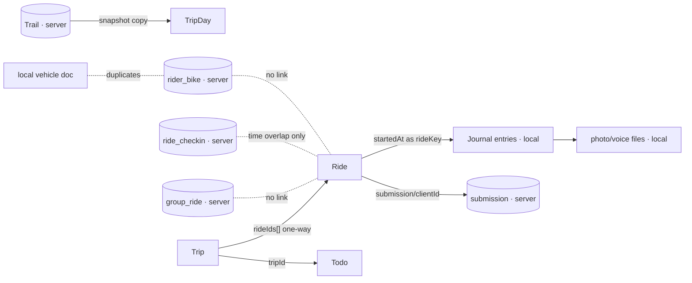
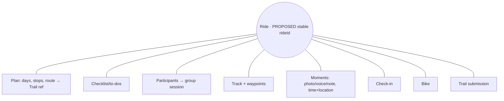

# Myto Rider Ops — Product & System Audit

Date: 2026-10-30 · Branch `feat/ride-companion` · Repo version 0.8.0 · 243 commits (2026-10-24 → 2026-10-30)

## How to read this

- **Method.** Four read-only code explorations (mobile, web, backend/data, docs/design/tests), plus my own spot-checks. Nothing was modified, no database was touched, no `.env` was read.
- **Evidence tags.** **[V]** = I re-checked it myself in the code or by running a read-only script. **[A]** = reported by an exploration agent from file reads, with a file reference, not independently re-checked. **[I]** = inference. **[NV]** = not verifiable here.
- **Not done (limits).** I did not run the app on a device or simulator, did not sign in, did not see production Supabase/R2/Vercel config, and did not run `npm audit`/`npm outdated`. No journey below was *executed*; every journey is a code-path trace. Anything needing GPS, a device, a real account or hosted config is marked NV.
- **One correction made during the audit.** An agent claimed the sitemap has no country-level entries. Wrong: `querySitemapEntries` emits region paths grouped by `country_slug` (`apps/web/src/server/queries/trails.sql.ts`, fixed in 29b57d2). Dropped.

## 0. The most important finding: the brief and the product disagree

The audit brief describes a **Rider Operating System** with the Ride as the central object. The repo's own product documents describe something narrower:

- `PRODUCT.md:3` — "a trustworthy, community-contributed, moderated directory of motorcycle trails, opening country by country".
- `PRODUCT.md:5` non-goals — not a social network. `docs/12:92` lists ride recording, offline use, messaging and native apps as *not in the first release*.

The code has since moved well past that: the mobile app records rides, journals, runs group rides and check-ins. So the **product has outgrown its own spec without the spec being updated**, and the Ride-OS direction in the brief is not yet a decision recorded anywhere. Before building toward it, the owner needs to decide whether Myto is (a) a trail directory with a ride companion, or (b) a rider OS. Everything in section 9 assumes (b), as the brief asks.

---

## 1. Executive audit

### 1.1 What Myto is today
Two products sharing one backend:
1. **Web (Next.js, `apps/web`)** — a moderated, evidence-backed public trail directory with a contribution wizard and moderation tooling. This is the mature half: strong data model, verification/expiry logic, upload hygiene, sound auth.
2. **Mobile (Expo, `apps/mobile`)** — a **local-first** ride companion: recorder, ride log, trips, to-dos, journal, documents, SOS/crash/check-in, group rides, clubs. Rich, but almost all personal data lives on the phone only.

### 1.2 How close to a Rider OS?
**Roughly 40%.** The pieces of the riding lifecycle mostly exist as *features*. The Ride is not an *object*: the server has no ride, trip, journal, to-do, voice note or GPS track at all [A], and on the phone they link by timestamp or not at all.

### 1.3 Strongest capabilities
1. Crash-safe recording: every fix goes to SQLite before anything else; recovery on relaunch; idempotent finish (`recorderCore.ts:89,97`, `finishCore.ts:25-46`) [A].
2. Trail data trust model: verification levels, expiry with grace, closure decay, moderator re-check cadence, two-approver rule for restricted trails [A].
3. Upload pipeline: type/size/pixel limits, re-encode from bytes, EXIF stripped, quarantine, rate limits [A].
4. Auth: magic link that scanners can't burn, PKCE app handoff, hashed tokens, owner-scoped queries with 404 not 403 [A].
5. Safety honesty: SOS and crash copy says "does not replace emergency services", "Beta. Not tested on real falls" [A].

### 1.4 Five most serious product gaps
1. No Ride object linking plan → record → journal → recap (section 4).
2. Rides, journals, trips, to-dos live only on the phone: no sync, no multi-device, no loss protection beyond a manual encrypted file [A].
3. Trip plans have no stops, ETA, fuel stops, invite, duplicate, or "make this a group ride" [A].
4. Journal moments carry time only — no location, so no moment-on-map timeline [A].
5. Ride → public trail contribution omits photos and journal, has no retry queue, and never hears back about moderation outcome [A].

### 1.5 Five most serious UX problems
1. **Join-by-invite sign-in dead-end** [V]: `app/join/[code].tsx:62` pushes `/auth`, which only re-exports the callback screen (`app/auth/index.tsx`). A signed-out rider tapping an invite appears to hit a screen with no code. (Code-read; not run on device.)
2. Home ignores an active or just-finished ride; new riders see a seeded "(sample)" ride as "Your latest ride" [A].
3. Native wake lock not applied [V `RecorderHost.tsx:39`, web only]; without Always-location, recording stops when the phone locks [A].
4. **SOS is a plain tap** while Stop is a 1 s hold — contradicting the component's own note [A].
5. "You" tab is long (16 rows in two groups, "Keep track" and "Settings", which mixes ride history with settings); "Ride" vs "Plan a trip" lead to different data models [A].

### 1.6 Five most serious architectural problems
1. No server-side ride/trip/journal/todo/track entities; planned `/sync/push`, `app.device`, `sync_cursor` (docs/15) do not exist [A].
2. `rideKey = ride.startedAt` (a timestamp) is the only journal↔ride link [V `journalEntries.ts:4`].
3. Three overlapping "next ride" stores (`trailStore.nextTrip`, `useTrips`, `useMyRoutes.followId`) and two bike stores (local vehicle, server `rider_bike`) [A].
4. The check-in "tell my contact" email depends on a **daily** cron with a 24 h catch window [V `vercel.json`: `30 3 * * *`; window per agent, `checkins.ts:200-204`]. For a safety feature this is the sharpest edge.
5. Draft contributor photos are written to the **public** object prefix at upload, before moderation (`uploads/service.ts:171-193`) [A].

### 1.7 What prevents coherence
Features were built vertically (each with its own store and screen) without a shared ride identity, and the docs that would have governed this are stale (docs/00 says "no code exists"; docs/14 "planning only").

### 1.8 Single most important next improvement
**Give the ride a real identity** — a stable `rideId` on-device (and later server-side), with trip, journal entries, to-dos, check-in, group session and submission all referencing it. It is mostly connection work on existing modules, not new features.

### 1.9 Scores (out of 10, with the evidence)

| Dimension | Score | Why |
|---|---|---|
| Product coherence | 4 | Two "next ride" models, spec vs product mismatch, Ride/Trip/Group unlinked |
| Information architecture | 5 | Dash/Trails/Clubs/You + raised Ride button is clean, but "You" mixes ride history ("Keep track") with settings and plan/ride split is confusing |
| User experience | 6 | Thoughtful details (typing locked while moving, hold-to-stop, honest copy); dead-end on join, sparse loading states |
| Feature integration | 3 | Only trip↔ride (one-way) and trip↔todo are linked by id |
| Trail discovery | 7 | Search, filters, sort, regions, nearby, strong detail page; no waypoints/fuel, rider reports missing on web, no `applyNow` on list |
| Trip planning | 3 | Multi-day with one route per day; no stops/ETA/invite/duplicate |
| Ride recording | 8 | Durable recorder, pause/auto-pause, recovery; untested native bridges, no native wake lock |
| Journaling & memories | 4 | Note/voice/photo exist; no geo, no cross-ride timeline, local only |
| Community | 4 | Clubs with admin and posts, server-backed; web clubs login-only, no chat, no events beyond posts |
| Group rides | 5 | Code-join, live positions, signals, regroup; no trip link, no push, no public discovery |
| Safety | 5 | Honest and real locally; crash detection unvalidated; contact email latency; no community help |
| Web/mobile continuity | 3 | No universal links/AASA/smart banner [V]; custom scheme only |
| Design consistency | 5 | Tokens + checks exist; web contradicts its own DESIGN.md; colour check failing |
| Technical architecture | 6 | Web/back-end strong; mobile data is device-bound; docs drift |
| Offline readiness | 4 | Recording and local data work offline; API cache is memory-only; no tiles by default |

These are judgments from code reading, not user testing.

---

## 2. Feature inventory and status matrix

Status key: **W** working · **I** incomplete · **B** broken · **D** disconnected · **P** partial · **N** not implemented · **NV** not verifiable.

| Feature | Platform | Status | Implementation | Major gap | Pri |
|---|---|---|---|---|---|
| Passwordless sign-in | Web | W | Magic link, hashed sessions | No CAPTCHA | P3 |
| App sign-in (PKCE) | Both | W | `/auth/app` → `myto://auth` | Custom scheme only | P2 |
| Invite sign-in on join | Mobile | **B** [V code] | `join/[code].tsx:62` → `/auth` | Dead-end | **P0** |
| Trail search/suggest | Web+Mobile | W | tsvector+trigram; suggest | No rate limit on suggest | P3 |
| Filters/sort | Web | W | terrain, difficulty, access, month, km | No elevation/duration/recently-verified | P2 |
| Map/list discovery | Web | W | 500-point cap | Basemap prod config NV | P3 |
| Mobile "Near you" | Mobile | I | `useTrailSearch('')` | Not location-based | P1 |
| Trail detail | Web | I | Strong; verification badges | No waypoints, fuel/rest, rider reports | P1 |
| Trail detail | Mobile | W | Save, ridden, offline pack, plan, ride | — | — |
| Stale-status handling on list | Web | **B** | `/trails` skips `applyNow` | Expired closure can show | P1 |
| Save trails | Both | W | collection + sync | — | — |
| Offline trail pack | Mobile | W | `trailStore.offline` | Tiles depend on provider | P2 |
| GPX download | Web | W | Consent page, sanitised, rate-limited | — | — |
| Share trail link | Web | N | No share action on trail page | | P2 |
| Universal links / app banner | Web | **N** [V] | none | Custom scheme only | P1 |
| Trip planning | Mobile | I | Days + one route/day | Stops, ETA, fuel, invite, duplicate | P1 |
| Route builder | Mobile | W | `/plan`, GPX import/export, share link | Detached from trips | P2 |
| Pre-ride checks | Mobile | W | `ride/index` | "Simulated (testing)" chip user-visible | P3 |
| To-dos | Mobile | I | Templates, trip packing, reminders | No ride/bike link, no sharing | P1 |
| GPS recording | Mobile | W | SQLite WAL, background task | No native wake lock; bridges untested | P1 |
| Crash recovery | Mobile | I | Offered on Home mount only | Hidden if Home isn't first | P2 |
| Active ride screen | Mobile | I | Large controls, hold-stop | SOS tap; small top-bar links | P1 |
| Journal (note/voice/photo) | Mobile | I | Local; typing locked when moving | No geo, no sync, no map | P1 |
| Ride log / story / recap | Mobile | W | GPX export, share trimmed | No search/filter | P2 |
| Year recap | Mobile | W | Share picture | — | P3 |
| SOS sheet | Mobile | I | Call/share/contacts offline | Tap-to-open; nothing auto-sent | P1 |
| Crash detection | Mobile | I | Opt-in beta | Unvalidated on real falls | P1 |
| Check-in "tell my contact" | Both | I | Server timer + `/track` | Email via daily cron; contact email optional | **P0** |
| Community help requests | — | **N** | grep: no code | | P3 |
| Group rides | Mobile+API | I | Code join, live positions, signals | No trip link, no push, 1 group at a time | P1 |
| Group-ride discovery | Both | N | Invite landing only | | P2 |
| Clubs | Both | I | Join requests, roles, posts, RSVP | Web login-only; no chat; no push | P2 |
| Rider profile | Web | I | Login-only | No public SEO profile | P3 |
| Bike (server) | Mobile | I | One bike, catalogue | Not tied to rides/todos | P1 |
| Documents/vehicle | Mobile | I | Local, **unencrypted** | Duplicates bike | P1 |
| Fuel costs | Mobile | I | Single mileage | Not per bike | P3 |
| Maintenance | Mobile | I | Generic todo templates | App-km only | P2 |
| Expenses beyond fuel | — | N | | Optional | P3 |
| Passport (ridden trails) | Mobile | D | Server `trail_ridden` | Not derived from rides | P2 |
| Ride → trail submit | Mobile+Web | I | Long form, GPX, trim | No photos, no queue, no outcome | P1 |
| Web contribution wizard | Web | W | 6 steps, autosave, duplicate warn | Can't edit published trail | P1 |
| Moderation | Web | W | Queue, 2-approver, audit | One country per moderator | P3 |
| Condition reports | Mobile | W | Offline outbox | Not shown on web trail page | P1 |
| Living trail record | Backend | **I** | Revisions, events | `kind='edit'` has no creator | P1 |
| Data sync (rides etc.) | Both | **N** | none | | **P0** (for OS vision) |
| Backup | Mobile | W | Encrypted export/import | Manual | P2 |
| Account deletion | Both | W | Cascade, documented | No re-auth | P3 |
| i18n | Both | N | English hard-coded | Planned non-goal | P3 |
| Dark mode | Mobile | I | Palette exists, root forced light | By design for planning | P3 |
| E2E tests | Both | N | none | | P2 |
| CI colour/version checks | Repo | **B** [V colours] | See §7 | | P1 |

---

## 3. Screen-by-screen (mobile, web summary)

### Mobile (40 routes, file:`apps/mobile/app/…`) [A unless noted]
Data: **L** local, **S** server, **M** mixed.

| Route | Purpose | Data | Status / problems |
|---|---|---|---|
| `(tabs)/index` Dash | Hub | M | Full. No active/just-finished state; sample ride shown to new riders; "Near you" not location-based; bare "Loading" text |
| `(tabs)/trails` | Search | S | Full |
| `(tabs)/clubs` | Clubs | S | Full; sign-in needed; no offline |
| `(tabs)/you` | Hub | M | 16 rows in groups (Keep track, Settings); ride history sits beside settings |
| `ride/index` | Pre-ride + start | L | Full; "Simulated (testing)" chip visible |
| `ride/live` | Active ride | L (+S group) | Full; SOS tap; small text links; no native wake lock |
| `rides/index` | Ride log, GPX import | L | No sort/filter/search |
| `story/[id]` | Ride summary | L | Primary post-ride screen; no recap/timeline |
| `story/submit` | Trail submission | S | Long form; no photos; no queue |
| `recap` | Year in review | L | — |
| `plan` | Route builder | L | Detached from trips |
| `trail/[id]` | Trail detail | S+offline | Heaviest card screen (6 `<Card`) |
| `trips/index`, `trips/[id]` | Trips | L | No duplicate/share/stops |
| `todos/*` | To-dos | L | 3 taps/2 screens to add one |
| `journal/*` | Journals | L | No geo/timeline |
| `join/[code]` | Accept invite | S | **Dead-end sign-in** [V] |
| `safety` | Crash settings | L | Beta |
| `club/[id]` | Club | S | Full |
| `bike`, `passport`, `fuel` | Profile bits | S/S/L | Single bike |
| `documents/*` | Licence/vehicle/contacts | L | Unencrypted at rest (`persist.ts:5`) |
| `notifications/*` | Inbox/prefs | L | Exposes "motion trace" dev toggle |
| `backup/*`, `danger`, `delete-account`, `region`, `coming-soon`, `legal/[doc]`, `auth/*` | Utilities | L/S | `legal` not reviewed |

Hosts mounted globally (`app/_layout.tsx`): Recorder, Companion, Crash, Notification, RideNotification, Voice. Together they form the app's real "OS layer" and have **no tests** for the native bridges [A].

### Web (public/auth/mod) [A]
`/`, `/trails`, `/trails/[slug]` (+`download`, `report`, `gpx`), `/regions/**`, `/countries`, `/saved`, `/submit/**`, `/account/**`, `/club/**` (login-only), `/riders/[id]` (login-only), `/join/[code]`, `/route/[id]`, `/track/[token]`, `/moderate/**`, `/sign-in`, `/welcome`, `/auth/app*`, static pages, `/design` (public in prod, noindex).
Problems: no `error.tsx`/global `not-found.tsx`; loading files missing for regions/submit/account; AVIF generated but never served; no `og:image`/Twitter card; thin JSON-LD; brand naming mixed (Moto Trails / Myto); page-title styles inconsistent.

---

## 4. Ride-centred data audit (highest priority)

### 4.1 Verdict on the Ride object
- **On-device:** `Ride` is a first-class record (`store/rides.ts`): id, name, startedAt, duration, distance, points, waypoints, submission. **[A]**
- **On server:** **no ride entity** (and no trip, to-do, journal, voice, expense, maintenance, checklist, emergency-contact table) [A, from migrations M0002–M0027]. Server holds only: `trail`/`route` (published geometry), `shared_route` (a trimmed jsonb line), `ride_checkin`, `group_ride`, `condition_report`, `submission`.
- `rideKey` does not exist anywhere server-side.

### 4.2 Answers to the 15 questions
| # | Question | Answer |
|---|---|---|
| 1 | Ride first-class? | Locally yes; server no |
| 2 | Todos attached to ride? | No. To trip (`todo.tripId`) only; service items use app-wide km |
| 3 | Journals ride-specific? | Loosely: `rideKey = startedAt` timestamp [V] |
| 4 | Photos tied to trips? | Photo → journal entry → ride via timestamp; local file named by entry id |
| 5 | Voice linked to location/time? | Time only; no lat/lng |
| 6 | Multiple participants? | Only via a separate `group_ride` with no link to a recorded ride |
| 7 | Each participant keeps own record? | Each phone records own ride; nothing ties them to the group |
| 8 | Route reusable? | Yes: "my routes", shared route link, published trail |
| 9 | Ride based on a trail? | Trip day stores a frozen trail snapshot; ride has no trail id |
| 10 | Deviate and still valid? | Yes, recording is independent of the plan; off-route buzz only |
| 11 | Completed rides editable? | Rename/delete; submission re-upload ("Upload again") |
| 12 | Duplicate/template? | No |
| 13 | Private + public coexist? | Yes: submission is a separate server draft with trim option |
| 14 | Consistent relations? | No (below) |
| 15 | Duplication? | Yes (below) |

### 4.3 Link map (current)

### 4.4 Duplications and inconsistent identifiers [A]
- **Next-ride intent** in three stores: `trailStore.nextTrip`, `useTrips`, `useMyRoutes.followId`.
- **Bike** twice: local `vehicle` and server `rider_bike`, never reconciled.
- `trip.items` legacy ("Nothing reads it").
- **Condition vocabularies** x3: `condition_event.status`, `condition_report.kind`, `trail_comment.tag`.
- **IDs:** trails by slug (API) / uuid (internal); users/clubs have uuid + `public_id`; comments, checkins, group rides use raw uuids; idempotency keys differ (`uuid` vs `text 8-64`).

### 4.5 Proposed Ride-centred relationship (conceptual — **not existing**)

Recommendation level: **connect, don't rewrite.** Add a stable `rideId` and reference fields (`rideId` on trip day/journal/todo/check-in/group/submission; `bikeId` on ride; `trailId` on ride). No server DB rewrite is justified yet; a server ride table is only needed when sync is built.

---

## 5. Lifecycle and state transitions [A]

Present states are **derived**, not stored:
- Ride recorder: `idle/running` + `paused` boolean (`recorderCore.ts:16,30`). No draft/planned/completed on a ride.
- Trip status: `logged | upcoming | ready | active | done | missed`, derived from dates (`lib/tripPlan.ts:28-37`). An unstarted trip ends `missed`.
- Contributed: `ride.submission.status === 'submitted'` only; moderator outcome never returns.

| Transition | Today | Gap |
|---|---|---|
| Draft → Planned | Trip created with a date | No "draft" concept |
| Planned → Active | Rider presses Start trip / Start ride | Ride recording can start with no plan; auto-attach to active trip |
| Active → Completed | Hold Stop → persist → clear journal (idempotent) | Strong |
| Kill/crash mid-ride | Recovery offered on **Home mount only** | Add an app-start/global prompt |
| Offline | Recording fine; condition reports queued; check-in create/group/submit need network | No submission queue |
| Completed → Contributed | Manual form | Outcome never returns; no retry queue |

Recommendation: store an explicit `status` on a ride/plan only once `rideId` exists; keep the derived trip statuses.

---

## 6. User-flow and friction analysis

Counts are **estimates from code reading** unless marked.

| # | Journey | Completable? | Key friction / break |
|---|---|---|---|
| 1 | Discover & save a trail | Yes (web & mobile) | Signed-out save routes via sign-in and back (works) |
| 2 | Ride from existing trail | Yes | "Ride now" and "Plan a trip" create different models |
| 3 | Multi-stop trip | **Partly** | Stops only in `RouteBuilder` (`/plan`), one route per day; no ETA/fuel/reorder at trip level |
| 4 | Prepare | Yes | To-dos local, trip pack list; no ride readiness; 3 taps/2 screens per item |
| 5 | Create/publish group ride | Create yes; **publish no** | No public discovery; club link via post |
| 6 | Join group ride | Code/link yes | **Dead-end sign-in when signed out** [V code] |
| 7 | Record | Yes | Strong; wake lock/Always-permission caveat |
| 8 | Journal/media | Yes locally | No geo; typing locked while moving (good) |
| 9 | Request assistance | SOS/check-in yes; **community help no** | SOS tap; check-in email latency |
| 10 | Finish & recap | Yes | No post-ride Home state; straight to story |
| 11 | Publish trail from recording | Yes | Long form (12 validations), no photos/queue/outcome |
| 12 | Web → mobile continuity | **No** | No universal links, no "Open in app" on trail page [V] |

Ideal simplified flow for #2–#4: *Trail → "Plan this" → one plan screen (date, stops auto-filled from trail waypoints, pack list auto-added, "Invite riders" toggle)*. Currently the rider rebuilds name/date/route/checklist across `PlanTripSheet`, `/plan`, `/todos/new`, `GroupSheet`.

Not tested (NV): any journey needing a device, GPS, push or a real account.

---

## 7. Cross-cutting findings

### 7.1 Safety and privacy
- **Verified:** check-in cron is daily [V]; public views filter `lifecycle='published'`; sensitive trails expose public point only [A].
- **Agent-reported verified-in-code:**
  - Draft photos public at upload (`uploads/service.ts:171-193`).
  - No retention purge for `login_token`, expired sessions, `upload`, unsubmitted drafts, `condition_report.lat/lng` (kept forever), check-in/group rows, `shared_route` [A].
  - `hashIp` is unsalted SHA-256 (`request-context.ts:27-29`) [A].
  - API tokens have no expiry/rotation; every write uses one coarse scope; `DELETE /me` needs only a token [A].
  - Emergency card and contact email stored plaintext; phones are encrypted [A].
  - CSP allows `'unsafe-inline'` scripts (docs say nonce) [A].
  - No rate limit on `/api/nearby`, `/api/suggest`, group-ride join code attempts [A].
  - Local documents/licence/medical unencrypted at rest [A].
- **Potential, NV:** Supabase default grants could expose `public_countries` for writes via the REST anon key (P1); R2 bucket public scope; Vercel timeouts for in-request image processing.
- **Not found:** IDOR on rides/routes/uploads/shares; unpublished-trail leakage; journal/voice leakage (they never leave the phone) [A].
- **Repo hygiene [V]:** `apps/web/data.sql` (64,726 bytes) is a data-only `pg_dump` including `app_user`, `auth_session`, `login_token`, `api_token`, `contact_share` tables, and is **not gitignored** (`git check-ignore` exit 1). A `git add .` would commit personal data.

### 7.2 Quality
- Tests: mobile 79 files (all logic), web 154 (39 need PostGIS), domain 12, **no E2E**, no component/screen tests on mobile [A].
- **CI would fail**: `check:colors` [V] — hex literals in `apps/mobile/src/features/rideSurface/RideActivity.tokens.tsx` (also `dist/` artifacts, which are gitignored); `check:versions` crashes because `tooling/check-versions.mjs:20` and `release-please-config.json:16` still point at `ios/Myto/Info.plist` (renamed `MytoMoto`) [A].
- `check:tokens` passes but is a **ratchet**: baseline allows 241 hard-coded values (worst: `ride/live.tsx` 23, `trail/[id].tsx` 22) [A].
- Mixed major versions in one monorepo (TypeScript 5 vs 6, vitest 3 vs 5) [A]; `npm audit` reported 8 vulns (5 low/3 high) per backend agent, mostly nested under the Expo toolchain — not reviewed.
- `NSPrivacyCollectedDataTypes` is empty although the app sends email, live location, photos [A].
- Mobile default API base is `myto-trails.vercel.app`, not `moto-trails.com` — confirm for release [A].

### 7.3 Design system
- Web contradicts `DESIGN.md` (radii 0/2/4, no card-per-item): 89 `rounded-lg` (24 px by token), 43 `rounded-3xl` [A]. Mobile is a documented "soft survey" (rounded cards) — a different direction.
- Brand red differs across `#be3a23`, `#b0442e`, `#af442e` [A].
- Mobile token palette is a **hand copy** with a TODO to generate it [A].
- Mobile: forced light root (dark only for live ride) — a deliberate choice; Web: effectively no dark mode.
- A11y (measured, mobile): 48 `accessibilityLabel`, 53 `accessibilityRole`, 0 `hitSlop`, 0 `maxFontSizeMultiplier`. Fixed heights may clip at large text [I]. Sunlight readability: never tested on a phone outdoors per docs/16 [A].

### 7.4 Docs drift
docs/00 ("no code exists"), docs/14 ("planning only"), ARCHITECTURE.md ("Auth (Supabase)", "device token"), India-only gazetteer text, 0 ticked plan checkboxes in 15 plans, and **free-tier-only** (newer specs) contradicting paid-from-beta (docs/05, D-6, ADR 0002). docs/16 §11–13 is the only record of mobile feature status.

---

## 8. Proposed information architecture (not a UI design)

Current (mobile): **Dash · Trails · Clubs · You** + raised **Ride** button.
Brief's target: Home · Explore · Rides · Community.

**Assessment.** The current structure is already close; a rename and one real change gets there:
| Current | Recommended | Decision |
|---|---|---|
| Dash | **Home** (contextual: active ride → resume; upcoming trip + readiness; just-finished → recap; new rider → plan) | Improve |
| Trails | **Explore** (trails, map, saved, offline packs) | Retain, rename |
| Ride button + `rides`, `trips`, `story`, `journal`, `todos`, `recap` | **Rides** tab: Upcoming / Active / Completed, with one **ride workspace** (Overview, Route, Stops, Checklist, People, Moments, Recap) | **Consolidate** — biggest change |
| Clubs | **Community** (clubs, group rides, invitations; help later) | Retain, widen |
| You (16 rows) | Profile via avatar/secondary entry; Garage (bike+documents+maintenance); Settings; Backup | Relocate/regroup |

Keep the raised Ride/Record action as a **primary action**, not a tab: it matches the active-ride-first behaviour. Retire: `trailStore.nextTrip`, `followId`, `trip.items`, the separate "Plan a trip" vs "Ride this trail" models (merge into one plan object), `/auth` re-export route (replace with proper sign-in).

Active ride: keep dark, large controls, hold-stop. Change: SOS to hold or confirm-slide, add native keep-awake, one "Add moment" button (photo/voice/note + auto location) replacing the text "Journal" link.

Web (suggested public nav): Explore · Trails · Regions · Contribute; defer public group rides/clubs until a product decision (PRODUCT.md non-goal).

---

## 9. Gap register

Complexity S/M/L. Work type: B backend · F frontend · D data model · X design.

| ID | Gap | Evidence | Fix | Dep | Pri | Size | Type |
|---|---|---|---|---|---|---|---|
| G01 | Join invite sign-in dead-end | `join/[code].tsx:62`, `auth/index.tsx` [V] | Call real sign-in, preserve code, return to join | — | **P0** | S | F |
| G02 | Check-in email can be ~24 h late / missed | `vercel.json` [V], `checkins.ts:200-204` | Trigger sweep more often (external free scheduler / on-ping), widen window, tell rider in UI that email timing isn't guaranteed | free-tier rule | **P0** | M | B |
| G03 | `data.sql` with personal rows not ignored | git check-ignore [V] | `.gitignore` + delete/move | — | **P0** | S | repo |
| G04 | No ride identity; journal keyed by timestamp | `journalEntries.ts:4` [V] | Stable `rideId`; migrate `rideKey` | — | **P0** | M | F, D |
| G05 | Draft photos public pre-moderation | `uploads/service.ts:171-193` | Serve drafts from private prefix; promote on approval | B | P1 | M | B |
| G06 | Rides/journal/trips local only, no sync | docs/15 plan vs M0002–27 | Server ride/journal schema + sync after G04 | G04 | P1 | L | B, D, F |
| G07 | Trip lacks stops/ETA/invite/duplicate/→group | `trips/*` | One plan object reusing `RouteBuilder`; "invite" creates group | G04 | P1 | L | F, D |
| G08 | Journal has no location | `JournalEntry` fields | Add lat/lng at capture; "Add moment" | G04 | P1 | M | F |
| G09 | SOS tap vs hold; no native wake lock | `live.tsx`, `RecorderHost.tsx:39` [V] | Hold/slide SOS; `expo-keep-awake` on native | — | P1 | S | F |
| G10 | Crash recovery only on Home | `index.tsx:31` | Run in root layout | — | P1 | S | F |
| G11 | Universal links/AASA/banner missing | no `.well-known` [V] | Add AASA/assetlinks, "Open in app" | domain | P1 | M | B, F |
| G12 | Rider condition reports not on web | web agent | Render dated reports distinct from moderator status | — | P1 | M | F |
| G13 | `/trails` skips `applyNow` | `trails/page.tsx:54-55` | Apply at read | — | P1 | S | B |
| G14 | `submission.kind='edit'` unreachable | `service.ts:59` | Edit-from-published flow | — | P1 | M | B, F |
| G15 | Contribution lacks photos/queue/outcome | `submit.ts` step 5 `[]` | Photos, queue, status poll | — | P1 | M | F, B |
| G16 | CI `check:colors`, `check:versions` failing | [V]/[A] | Fix token file; update plist path | — | P1 | S | repo |
| G17 | Retention purges missing | grep per backend agent | Add purge jobs per docs/11 | — | P1 | M | B |
| G18 | Token model (no expiry, coarse scope, DELETE with any token) | `tokens.ts`, `routes.ts` | Expiry, finer scopes, re-auth on delete | — | P1 | M | B |
| G19 | Supabase grants on `public_countries` / RPC | M0024 | Inspect real grants; revoke explicitly | access | P1 (verify) | S | B |
| G20 | Bike unification (local vehicle vs server bike), ride↔bike | stores | Single Bike; `bikeId` on ride/todo | G04 | P2 | M | D, F |
| G21 | Home contextual states | `index.tsx` | Active/just-finished/new-rider variants; remove sample ride | G04 | P2 | M | F, X |
| G22 | "You" tab regroup, Garage | `you.tsx` | IA change | — | P2 | S | X |
| G23 | Rate limits on suggest/nearby/join | agents | Add | — | P2 | S | B |
| G24 | Privacy manifest empty | `PrivacyInfo.xcprivacy` | Declare collected data | counsel | P2 | S | F |
| G25 | Docs reconcile + ADR for free-tier | §7.4 | Update docs/00,14, ARCHITECTURE; ADR | — | P2 | S | docs |
| G26 | Web design vs DESIGN.md decision | §7.3 | Decide direction; update one of them | owner | P2 | M | X |
| G27 | Offline API cache memory-only | `cacheStore.ts` | Persist trail lists/clubs | — | P2 | M | F |
| G28 | E2E and native-bridge tests | none | Maestro/Detox for record→finish→recover | — | P2 | L | test |
| G29 | Community help requests | none | Defer until safety review; keep out of Home | policy | P3 | L | all |
| G30 | Expenses/maintenance beyond fuel/todos | — | Optional; only if per-bike | G20 | P3 | M | D |
| G31 | Trail waypoints/fuel/rest on trail page | web agent | Render waypoints from GPX | — | P3 | M | F |
| G32 | AVIF/blur placeholders, `og:image`, richer JSON-LD | web agent | SEO polish | — | P3 | S | F |

---

## 10. Roadmap

**Phase 1 — Foundation & integration (do first).** G01, G02, G03, G04, G09, G10, G13, G16; decide product scope (§0) and free-tier ADR (G25). *Outcome:* nothing broken in core journeys; a ride has an identity. *Dependency:* the §0 decision.

**Phase 2 — Complete the riding lifecycle.** G07, G08, G21, G15, G05, G12, G14; unified plan object; "Add moment"; recap/timeline from `story/[id]`. *Outcome:* find trail → plan → ride → remember → contribute with carried-forward data.

**Phase 3 — Community & coordination.** Link group rides to plans, public/club group-ride publishing, push (needs a free path, see below), G11 universal links. *Dependency:* G04, G07.

**Phase 4 — Rider intelligence.** G06 sync, G20 garage, offline persistence G27, trail intelligence from aggregated rider reports. *Optional:* G29–G31.

Note: push notifications are disabled (`enableRemoteNotifications:false`) and docs say push needs a paid Apple account (already evidently held, `app.json` team id); budget/free-tier rule needs an explicit answer before Phase 3.

---

## 11. Keep / Fix / Connect / Remove / Build

| Category | Items |
|---|---|
| **KEEP** | Recorder durability; trail verification/expiry model; upload pipeline; magic-link + PKCE auth; owner-scoped query pattern; hold-to-stop; typing lock while moving; honest safety copy; moderation with 2-approver rule; offline trail packs; encrypted backup |
| **FIX** | Join sign-in dead-end; check-in email latency; `data.sql`; CI checks; SOS tap; native wake lock; crash-recovery trigger; `/trails` stale status; draft photo exposure; token expiry/scopes; retention purges; privacy manifest; Home sample ride; unencrypted local documents |
| **CONNECT** | Trip ↔ group ride; ride ↔ bike ↔ to-dos; journal ↔ ride by id; moments ↔ location; check-in ↔ ride; submission outcome → app; web trail → app (universal links); condition reports → web page; passport ↔ recorded rides; vehicle ↔ server bike |
| **REMOVE** | `trailStore.nextTrip`, `followId` (fold into one plan); `trip.items`; `/auth` re-export; "Simulated (testing)" chip and "motion trace" toggle from release builds; duplicate condition vocabularies (merge); public `/design` in prod |
| **BUILD** | Stable `rideId`; unified plan object with stops/ETA; "Add moment"; ride recap/timeline; trip duplicate/template; ride sync (server); edit-published-trail flow; contribution queue + outcome; E2E tests; Garage |

---

## 12. Open decisions for the owner

1. **Scope — DECIDED 2026-10-30: Full Rider OS.** The roadmap above assumes this. Still to do: update PRODUCT.md and its non-goals (social network, ride recording, offline) so the docs match.
2. **Free-tier rule vs production reality:** older docs say paid from beta; newer say free-only. The check-in email (G02) is the first place this bites.
3. **Web design direction:** DESIGN.md (sharp, minimal) vs shipped (soft, rounded).
4. **Sync:** is cross-device/cloud backup of rides in scope? It is the largest architectural item (G06).
5. **Community help requests:** build at all? (Safety and abuse implications.)
6. **`data.sql`:** delete or ignore? It contains rows from user tables.

## 13. Not verifiable here
Device behaviour (GPS, background, battery, sunlight, gloves), push, App Store review, Supabase default grants and Data API exposure, R2 bucket scope/versioning, Vercel timeouts and real cron firing time, production migration level, `npm outdated`, backup encryption review, `legal/[doc]` and several skimmed screens (documents, club internals), `.env.local` contents.

## Addendum — UX review of the rendered app (2026-10-30)

First look at real screens (web build at phone size: Home, Trails, Clubs, You, "Ready to ride?", a trip). Not seen: the live ride screen, native behaviour, glove/sunlight use. Corrections to the above: "You" is already grouped (Keep track, Settings); "Ready to ride?" is already a readiness view; the trip screen already has Start trip, Days and Pack list. Observed: Trails, Clubs and Near you stayed on "Loading…" with no timeout or error (cause undetermined: no API request fired in the web build). Design health, judgment only: 27/40. See [phases](2026-10-30-rider-os-phases.md) and [ADR 0008](../adr/0008-rider-os-change-and-reversibility.md).
